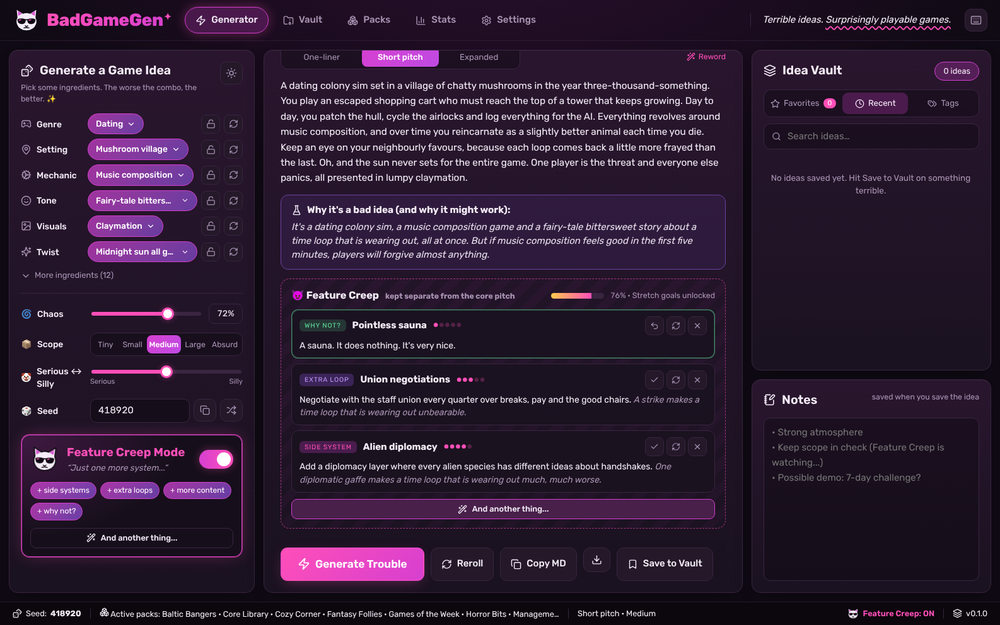

# BadGameGen

**Terrible ideas. Surprisingly playable games.**

An offline desktop generator of short, coherent and sometimes absurd game concepts, built at
**Bad Ideas Works**. It's driven by big editable content libraries rather than an LLM, and every
idea is reproducible from its seed.



## What it does

- **Generate Trouble.** Builds a titled concept with a one-liner hook, a short pitch, an expanded
  breakdown and a "why it's a bad idea (and why it might work)" verdict.
- **Real grammar, not word salad.** Every ingredient carries grammatical "forms" and sentences
  come from templates, with automatic a/an handling ("an RPG", "a unicorn", "an hour").
- **Reproducible.** The same seed with the same packs gives the same idea, forever. Seeds can be
  words ("crab office"). Recipe codes (`BGG1-…`) capture every lock, reroll and creep decision,
  so you can share an idea exactly.
- **Click any phrase to change it.** Every phrase in the hook and pitch that came from an
  ingredient is clickable: swap it for a suggested alternative, reroll it, lock it, choose a
  specific one or banish it. Hovering a phrase highlights its ingredient row, and vice versa.
- **One-click alternatives.** Each main ingredient shows two suggestions that fit the rest of
  the idea. Choosing one changes exactly that ingredient (and doesn't lock it).
- **Lock, pick, reroll, banish.** Lock any ingredient, pick one by hand, reroll just that one, or
  exclude it for good. Rerolling one field never disturbs the others.
- **Chaos, Scope, Serious↔Silly.** Chaos goes from grounded to audacious (high chaos lets
  normally incompatible combinations through). Scope runs from tiny jam to absurd and controls
  how many systems a concept gets. Tone goes from deadpan to clown shoes.
- **😈 Feature Creep Mode** (*"Just one more system..."*). Adds side systems, extra loops, more
  content and "why not?" features that are relevant to the concept. You can accept, reject or
  reroll each one, append more with **And another thing...**, and watch the **creep meter**
  climb toward "Sentient scope". Additions are kept separate from the core pitch.
- **Idea Vault.** Saved ideas keep a full snapshot, so they stay readable even after packs
  change. Search, favorites, tags, notes, rename, duplicate, delete with confirmation, and export
  to Markdown, plain text or JSON.
- **Editable library.** All packs, built-in ones included, live as plain JSON in your library
  folder (`%LOCALAPPDATA%\BadGameGen\packs`; use **Packs → Open library folder**). Edit one in
  any text editor and the app reloads it within seconds. If you break the JSON, it tells you the
  file and line. Updates never overwrite your edits: edited built-ins are marked and can be reset
  to the shipped version at any time.
- **Content packs.** 8 built-in packs with about 1,600 ingredients: Core, Horror Bits, Cozy
  Corner, Fantasy Follies, Sci-Fi Sundries, Baltic Bangers, Management Mayhem and Games of the
  Week. You can import your own; they're validated on the way in.
- **Colour schemes.** BadSad Plum, Frost Signal, Toxic Swamp, Noor's Purple Heart 💜, Arcade
  Sunset and Daylight Heresy (a light theme, for people who hate their eyes). Themes are JSON,
  so you can add your own.
- **💜 Noor Mode.** Feature Creep becomes permanent, every idea gets an extra proposal, a
  purple heart and commentary from Noor, and the theme turns purple. Toggle it in Settings, or
  type `n` `o` `o` `r` on the Generator.
- **Extras.** Bad Idea of the Day, procedural cover art, session history (back/forward),
  keyboard shortcuts (press `?`), stats, and a command-line companion.

## Running it

### Windows desktop app

**Just want to run it?** Use `BadGameGen.exe`, a single self-contained file with no installer
and no .NET install needed. On first launch it unpacks its packs, themes and UI into
`%LOCALAPPDATA%\BadGameGen\app\`. Your vault, settings, imported packs and custom themes
live in `%LOCALAPPDATA%\BadGameGen`. It needs the Microsoft Edge WebView2 runtime, which comes
with Windows 10 and 11.

> The exe isn't code-signed yet, so Windows SmartScreen may say "Windows protected your PC".
> Click **More info → Run anyway**.

**Building the exes yourself** (needs the .NET 10 SDK and Node.js 20+):

```powershell
powershell -ExecutionPolicy Bypass -File scripts/publish-windows.ps1
# → release/BadGameGen.exe and release/bgg.exe
```

The same works from Linux or macOS with `scripts/publish-windows.sh`, and CI builds both exes
on every push (Actions → BadGameGen-win-x64 artifact).

For development, run the loose-file build:

```powershell
cd frontend; npm install; npm run build; cd ..
dotnet run --project src/BadGameGen.Desktop
```

### Browser (dev server, any OS)

```bash
cd frontend && npm install && npm run build && cd ..
dotnet run --project src/BadGameGen.DevServer
# open http://localhost:5178
```

For hot reload, keep the dev server running and run `npm run dev` in `frontend/`, then open
http://localhost:5173. Dev data goes in `.devdata/`.

### Command line

```bash
dotnet run --project src/BadGameGen.Cli -- generate --seed "frost signal" --scope 2 --creep
dotnet run --project src/BadGameGen.Cli -- generate --count 10 --format hook --chaos 0.8
dotnet run --project src/BadGameGen.Cli -- validate            # check all packs
dotnet run --project src/BadGameGen.Cli -- validate my-pack.json
```

## Tests

```bash
dotnet test tests/BadGameGen.Core.Tests
```

111 tests cover:
- determinism, seed normalisation and pack-order independence
- locks, keeps, rerolls and exclusions
- chaos, silliness and scope behaviour
- Feature Creep (accept, reject, reroll, append, kind filters, meter)
- templates and articles, plus click-to-edit phrase tracking (tagged text always matches the
  plain text) and alternatives
- pack validation, the vault (including corrupt-file recovery), exporters and recipe codes
- the RPC API
- the editable library (updates, edits kept, deletions remembered, line-ending tolerance)
- a smoke test that generates 400 concepts across every slider combination and fails on any
  template debris

## Docs

- [docs/ARCHITECTURE.md](docs/ARCHITECTURE.md): how the pieces fit together.
- [docs/CONTENT_GUIDE.md](docs/CONTENT_GUIDE.md): writing content packs and templates.
- [docs/IDEAS.md](docs/IDEAS.md): roadmap and the studio's own feature creep.
- [docs/DESIGN_BRIEF.md](docs/DESIGN_BRIEF.md) and [docs/UI_Mockup.png](docs/UI_Mockup.png):
  the original brief.

---

*Bad Ideas Works motto #001: "Code shall remain understandable to whichever AI inherits this mess."*
